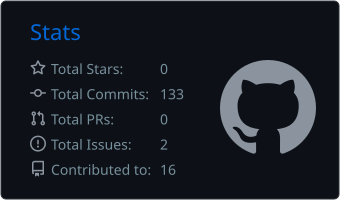
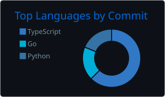
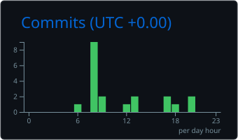

# Aditya Bishnoi (Aadi)

### Full-Stack Developer · Web Applications · APIs · Desktop Tools

I build web experiences, backend services, digital platforms, and cross-platform tools.

---

## About Me

- 💻 I work across frontend development, backend systems, APIs, authentication, and deployment.
- 🌱 Currently learning and building Discord bots and integrations with the Discord API, including slash commands, event handling, and OAuth2.
- 🧩 Interested in developer tools, online platforms, automation, and community infrastructure.
- ⚡ Fun fact: I'm a workaholic.

## Featured Projects

<table>
  <tr>
    <td width="50%">
      <h3><a href="https://www.zorzer.qzz.io">Zorzer</a></h3>
      
A project focused on network stress-testing tools.

      <a href="https://www.zorzer.qzz.io">Visit project →</a>
    </td>
    <td width="50%">
      <h3><a href="https://github.com/aadi-devs/Anuverse-Web">Anuverse Hosting</a></h3>
      
A website project for Minecraft and web hosting services.

      <a href="https://github.com/aadi-devs/Anuverse-Web">View repository →</a>
    </td>
  </tr>
  <tr>
    <td colspan="2">
      <h3><a href="https://www.empirialprops.com">Empirial Props</a></h3>
      
A prop-firm and trading-education content platform.

      <a href="https://www.empirialprops.com">Visit website →</a>
    </td>
  </tr>
</table>

> Explore more projects on my [GitHub profile](https://github.com/aadi-devs) or [portfolio](https://victus.wtf).

## GitHub Analytics

## Contribution Activity

## Languages, Tools & Technologies

### Languages

  

### Frontend & Frameworks

  

### Backend & Databases

  

### Tools & Infrastructure

  

## Connect

- **Portfolio:** [victus.wtf](https://victus.wtf)
- **Email:** [victuslofimusic@gmail.com](mailto:victuslofimusic@gmail.com)
- **Instagram:** [@aadi.bishnoi](https://instagram.com/aadi.bishnoi)
- **Discord:** [aadi.dev community](https://discord.gg/aadi.dev)

---

*Thanks for stopping by — feel free to explore my repositories.*

